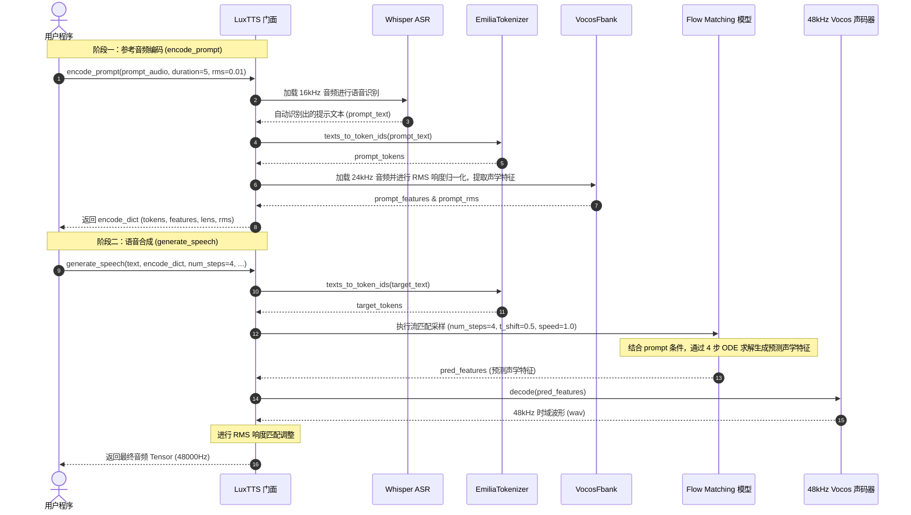

# LuxTTS 项目架构设计文档

本文档深入解析 **LuxTTS** 的系统架构、各层模块的职责划分、核心算法模型以及数据处理与推理的完整流转过程。

---

## 1. 系统总体架构设计

LuxTTS 是基于 ZipVoice 架构进行深度演进的轻量级、超低延迟零样本文本转语音（Zero-Shot TTS）与声音克隆框架。其整体系统分为四层：

```mermaid
graph TD
    subgraph 接入层 (API & Entry)
        MainPy["main.py (应用入口)"]
        UserScript["第三方脚本 / WebUI / API 服务"]
    end

    subgraph 门面与控制层 (Facade & Orchestration)
        LuxTTSClass["LuxTTS (zipvoice.luxvoice.LuxTTS)<br/>统一入口门面、设备探测、调度器"]
    end

    subgraph 算法与模块层 (Core Algorithms & Models)
        ASR["ASR 转写模块<br/>(OpenAI Whisper Base / Tiny)"]
        Tokenizer["文本分词模块<br/>(EmiliaTokenizer / Piper Phonemize)"]
        FBank["声学特征提取器<br/>(VocosFbank 24kHz/48kHz)"]
        AcousticModel["Flow Matching 蒸馏声学模型<br/>(ZipVoiceDistill / OnnxModel)"]
        Vocoder["神经声码器<br/>(Vocos 48kHz 神经声码器)"]
    end

    subgraph 硬件与后端执行层 (Execution Backends)
        CUDA["NVIDIA CUDA (PyTorch)"]
        MPS["Apple Silicon MPS (PyTorch)"]
        CPU["ONNX Runtime CPU (多线程引擎)"]
    end

    MainPy --> LuxTTSClass
    UserScript --> LuxTTSClass

    LuxTTSClass --> ASR
    LuxTTSClass --> Tokenizer
    LuxTTSClass --> FBank
    LuxTTSClass --> AcousticModel
    LuxTTSClass --> Vocoder

    AcousticModel --> CUDA
    AcousticModel --> MPS
    AcousticModel --> CPU
    Vocoder --> CUDA
    Vocoder --> MPS
    Vocoder --> CPU
```

---

## 2. 模块职责与源码映射

| 模块名称 | 对应源码路径 | 核心职责 |
| :--- | :--- | :--- |
| **对外门面层 (Facade)** | [`zipvoice/luxvoice.py`](../zipvoice/luxvoice.py) | 暴露 `LuxTTS` 类；根据环境自动检测并分发设备（CUDA $\rightarrow$ MPS $\rightarrow$ CPU）；组装初始化各底层模型；封装 `encode_prompt()` 与 `generate_speech()` 对外 API。 |
| **GPU/MPS 推理管道** | [`zipvoice/modeling_utils.py`](../zipvoice/modeling_utils.py) | 实现基于 PyTorch 的加载函数 `load_models_gpu()`；音频加载与响度标准化 `process_audio()`；基于 PyTorch 的 Flow Matching 推理流程 `generate()`。 |
| **CPU ONNX 推理管道** | [`zipvoice/onnx_modeling.py`](../zipvoice/onnx_modeling.py) | 实现 CPU 下轻量高效推理；`OnnxModel` 封装 Text Encoder 与 FM Decoder 的 ONNX Runtime 会话；`sample()` 实现 CPU 上的 flow matching 步进采样；`generate_cpu()` 完成全流程波形生成。 |
| **声学模型 (Acoustic)** | [`zipvoice/models/zipvoice_distill.py`](../zipvoice/models/zipvoice_distill.py)<br/>[`zipvoice/models/zipvoice.py`](../zipvoice/models/zipvoice.py) | ZipVoice 蒸馏模型结构；包含文本编码器（Text Encoder）、持续时间预测器（Duration Predictor）与基于向量场估计的 Flow Matching 解码器。 |
| **文本分词与正则化** | [`zipvoice/tokenizer/`](../zipvoice/tokenizer/) | 包含 `EmiliaTokenizer`、中文正则化（`ChineseTextNormalizer`）、英文正则化（`EnglishTextNormalizer`）、拼音转换（`pypinyin`）与国际音标/音素提取（`piper_phonemize`）。 |
| **48kHz 神经声码器** | `linacodec.vocoder.vocos` | 基于 Vocos 架构的定制化 48kHz 声码器，负责将 Flow Matching 输出的梅尔/声学特征图解码恢复为 48,000Hz 高保真时域音频信号。 |

---

## 3. 核心运行流程与数据流图

LuxTTS 的运行分为两大阶段：**参考音频编码阶段（Prompt Encoding）**与**语音生成阶段（Speech Generation）**。



---

## 4. 关键算法与技术机制

### 4.1 4 步流匹配蒸馏 (Flow Matching Distillation)
- **原理**：标准的 Flow Matching 或扩散模型生成通常需要 30 ~ 100 步迭代求解 ODE/SDE，延迟较高。LuxTTS 基于 ZipVoice Distill 蒸馏技术，学习将速度场向量直接映射到 3~4 步大步长积分上。
- **时间步调度 (Time Schedule) 与 Anchor-based ODE**：
  在 ONNX 与 PyTorch 实现中，通过公式调度时间步：
  $$x_t = (1 - t) x_0 + t x_1 \implies v = x_1 - x_0$$
  通过网络预测速度场 $v$，直接计算出目标预测值 $x_1$ 与初值 $x_0$，并在中间步长使用锚点（Anchor）进行状态更新：
  $$x_{next} = (1 - t_{next}) x_0^{pred} + t_{next} x_1^{pred}$$
  最后一步直接吸附到无噪数据 $x_1^{pred}$，实现极高速度与高稳定度。

### 4.2 48kHz 高保真声码器
- 传统 TTS 模型通常输出 16kHz 或 24kHz 波形，高频细节（如气音、齿音）容易发闷。
- LuxTTS 搭配定制的 48kHz Vocos 频域声码器，频率上限达到 12,000Hz 甚至更高，大幅提升声音的通透度与真实质感。

### 4.3 零样本声音克隆 (Zero-Shot Voice Cloning)
- 结合自动语音识别（Whisper ASR）与声学特征提取器，从输入的 3~5 秒参考音频中解耦并提取**发音人音色向量与风格条件**，将其与目标文本的音素序列拼接作为 Flow Matching 的条件输入（Conditioning），无需微调模型即可实时复刻目标发色。

---

## 5. 文本与音素系统设计 (Tokenizer & Language Support)

LuxTTS 的文本前端采用基于 Emilia 数据集构建的 `EmiliaTokenizer`（360 个 Token），整体设计专注于中英文的高保真发音与紧凑表征。

```mermaid
graph LR
    InputText["输入文本<br/>(中英混合 / 带标点)"] --> Norm["文本规范化 (Normalizer)<br/>标点映射 / 缩写展开"]
    Norm --> Seg["语种切分器 (get_segment)<br/>识别 zh / en / pinyin / other"]
    
    Seg -->|中文| Pinyin["Jieba 分词 + pypinyin<br/>拆为声母(如 n0)与声调韵母(如 ao3)"]
    Seg -->|英文| IPA["piper_phonemize (espeak-ng)<br/>提取国际音标与重音符(如 ˈ/ˌ)"]
    Seg -->|显式拼音| ManualPinyin["解析 <pinyin> 标签<br/>直接输出指定声调音素"]
    Seg -->|其他(日/韩等)| Drop["OOV 未知字符过滤<br/>(无对应 Token，丢弃跳过)"]

    Pinyin --> TokenIDs["Token ID 序列 (tokens.txt)<br/>传递给 Flow Matching 声学模型"]
    IPA --> TokenIDs
    ManualPinyin --> TokenIDs
```

### 5.1 语种支持边界与技术分析
- **支持语言**：**中文（普通话）** 与 **英文**。
- **关于日语（Japanese）等其他语种的明确结论**：
  - **原生不支持日语**。
  - **根本原因**：
    1. **词表缺失（OOV）**：预训练模型词表 `tokens.txt` 仅包含 360 个 Token，涵盖英文字母、IPA 音素、汉语拼音声韵母及基础标点。日语的平假名（ひらがな）与片假名（カタカナ）在词表中**完全不存在**，分词时会被作为未知字符直接丢弃；
    2. **日文汉字误读**：若输入日文汉字（如“元気”），分词器会自动将其判定为中文字符，并强制使用中文发音（`yuan2 qi4`）朗读；
    3. **ASR 级联风险**：若参考音频为日语，前置 Whisper 模型转写出的日语文本同样会因为分词器无法识别而导致特征为空，进而引发模型下游卷积算子崩溃。

### 5.2 特殊符号、停顿与音高控制机制
- **自然停顿（Pause / Silence）**：
  - 词表中显式定义了基础标点符号（`,`、`.`、`!`、`?`、`;`、`:` 等）；
  - `map_punctuations()` 自动将全角标点标准化为半角；Flow Matching 声学模型在训练阶段已学习了逗号、句号、省略号对应的静音帧（Silence frames）与延展时长。
- **中文声调与精准控制**：
  - 模型词表原生支持带 1~5 调的拼音。分词器支持通过尖括号语法 `<pinyin>` 显式指定读音与音调（如 `<chao2><yang2>`），可精准纠正多音字或强制指定升降调。
- **英文重音（Stress）**：
  - 英文通过 G2P 引擎转换为音标时，会自动引入主重音 `ˈ` 与次重音 `ˌ`，并在词表中对应不同的重读时长与能量。
- **音高（Pitch）与情绪表达（Emotion）**：
  - **不支持 SSML 标签**：模型未定义 `<prosody>`、`<pitch>` 等 XML 标签，输入会被作为非法字符过滤；
  - **由参考音频驱动**：作为 Zero-Shot 声音克隆系统，音频的整体音高基准、情绪色彩与起伏度**直接继承自输入的参考音频（Prompt Audio）**。问号 `?` 能够辅助诱导句尾升调，若需要高音调或特定情绪，推荐直接提供相应语气风格的参考音频。

---

## 6. 多硬件适配设计

LuxTTS 在初始化时会智能自适应目标硬件：
1. **CUDA (NVIDIA GPU)**：
   - 使用完整 PyTorch 模型运行，速度突破 150x 实时，适合高并发生产环境。
2. **MPS (Apple Silicon GPU)**：
   - 适配 macOS 的 Metal Performance Shaders，在 Mac M1/M2/M3/M4 上免配置直接开启硬件加速。
3. **CPU (ONNX Runtime)**：
   - 当没有 GPU 时，无缝降级到 CPU；使用 ONNX 运行时，支持多线程算子加速（`inter_op_num_threads` / `intra_op_num_threads`），显存要求为 0，能在普通笔记本电脑上流畅运行。

