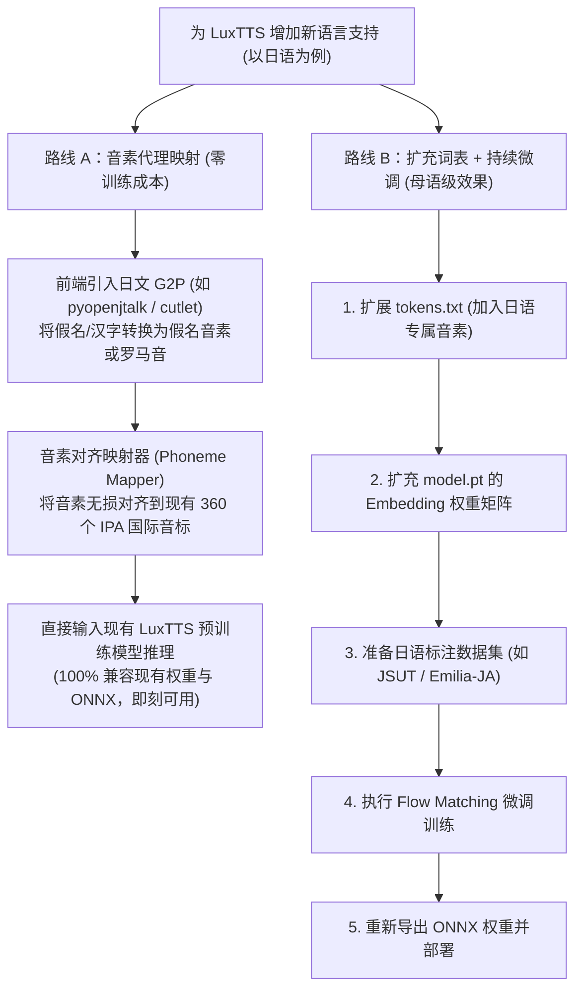

# LuxTTS 词表扩充与多语言微调指南 (Fine-Tuning Guide)

本文档面向希望为 **LuxTTS** 扩展新语言支持（以日语为例）或在特定垂直领域语音数据上进行微调（Fine-Tuning）的开发者，详细阐述底层限制、技术原理与两条具体实施路线。

---

## 1. 词表底层约束与直接改表的误区

### 1.1 为什么不能直接修改/追加 `tokens.txt`？
如果仅在 `tokens.txt` 尾部添加新语言的音素或字符（例如从 360 个扩展到 420 个），程序在加载时会发生崩溃，原因如下：

1. **Embedding 层维度刚性固化**：
   - 预训练声学模型权重文件（`model.pt`）与 CPU ONNX 模型（`text_encoder.onnx`）中，文本编码器的第一层嵌入矩阵被严格固化为：
     $$\text{Embedding Weight Shape} = (360, 512)$$
   - 若词表数量改变，PyTorch 会在加载模型时抛出尺寸不匹配异常：
     `RuntimeError: size mismatch for text_encoder.embedding.weight: copying a param with shape torch.Size([360, 512]) ... where current is torch.Size([420, 512])`
2. **缺乏声学映射先验**：
   - 即使绕过形状检查（如 `strict=False`），新增 Token 的 Embedding 向量也是未初始化的随机噪点。Flow Matching 解码器在预训练阶段从未学习过这些向量与声学特征间的关联，最终只能输出破音或杂音。

---

## 2. 扩展新语言的两大实施路线

针对发音体系规整的语言（如日语：由 5 个基础元音与十几个辅音组成），目前有两种可落地的工程路径：



---

## 3. 路线 A：音素代理映射（零训练成本，推荐优先尝试）

### 3.1 原理分析
经实测分析，现有 `tokens.txt` 虽仅有 360 个 Token，但已包含完整的英文字母与国际音标（IPA）：
- **元音**：`a`, `i`, `u`, `e`, `o` 均已存在；
- **主要辅音**：`k`, `s`, `t`, `n`, `h`, `m`, `j`, `r`, `w`, `g`, `z`, `d`, `b`, `p` 均已存在。

日语五十音图与促音、拨音均可拆解为上述元音与辅音的组合序列。因此，**无需重新训练声学模型**，只需在文本输入前端做一层音素借道转换。

### 3.2 实施步骤
1. **安装日文 G2P 工具**：
   ```bash
   pip install pyopenjtalk
   ```
2. **构建音素映射管道**：
   将日文汉字与假名转换为罗马音（Romaji）或 IPA 音标，并确保每个音标都存在于 LuxTTS 现有的 `tokens.txt` 中。
3. **直接调用推理**：
   将清洗转换后的音素序列输入 `lux_tts.generate_speech()` 进行合成。

### 3.3 优缺点与适用场景
- **优点**：
  - **研发成本极低**：无需 GPU 算力、无需收集训练数据集；
  - **即刻可用**：完全复用现有的 48kHz Vocos 声码器与 ONNX CPU 加速。
- **局限**：
  - 语调和重音沿用中英文的预训练先验，合成语音会略带“外国人口音说日语”的感觉，但可懂度良好。适合原型验证与轻量级对话。

---

## 4. 路线 B：扩充词表 + 持续微调（商业级原生方案）

若需达到母语级别的日语发音、声调与自然度，必须进行标准的词表扩充与模型持续微调。

### 4.1 实施步骤详解

#### 步骤 1：扩充词表 (`tokens.txt`)
在现有的 `tokens.txt` 尾部追加日语特定标记（例如促音、长音或特定假名音素），使词表大小从 360 扩展至 $N$（如 420）。

#### 步骤 2：权重矩阵尺寸扩展 (Embedding Expansion)
编写权重手术脚本，保留原有的预训练 Embedding 参数，并将新 Token 的向量进行合理初始化：

```python
import torch

# 1. 加载官方预训练权重
ckpt = torch.load("model.pt", map_location="cpu")
old_weight = ckpt["model"]["text_encoder.embedding.weight"]  # Shape: [360, 512]

# 2. 创建扩充后的 Embedding 权重 (假设新词表大小为 420)
new_vocab_size = 420
embed_dim = old_weight.shape[1]
new_weight = torch.zeros((new_vocab_size, embed_dim), dtype=old_weight.dtype)

# 3. 复制继承原有 360 个 Token 的预训练权重
new_weight[:360, :] = old_weight

# 4. 新增的 Token 使用正态分布小随机数初始化，或使用相似音素的均值初始化
new_weight[360:, :] = torch.randn((new_vocab_size - 360, embed_dim)) * 0.02

# 5. 写回并保存新权重基底
ckpt["model"]["text_encoder.embedding.weight"] = new_weight
torch.save(ckpt, "model_extended_init.pt")
print(f"成功将 Embedding 扩展至: {new_weight.shape}")
```

#### 步骤 3：准备训练数据集
- **语料推荐**：
  - [JSUT Dataset](https://sites.google.com/site/shinnosuketakamichi/publication/jsut)：约 10 小时高质量单一女性日语发音语料，开源免费。
  - [Emilia-JA](https://huggingface.co/datasets/amphion/Emilia)：大规模野生多人语音数据集的日语子集。
- **数据处理**：
  - 统一重采样至 24,000Hz 与 48,000Hz；
  - 提取 VocosFbank 特征；
  - 使用新分词器将文本标注转为 Token ID 序列。

#### 步骤 4：执行持续微调 (Continual Fine-Tuning)
- **冻结策略**：
  - 初期可先冻结 Flow Matching Decoder 的大部分骨干层，仅微调 `text_encoder` 和扩展后的 `embedding`，学习率设置为较低的 $1\times 10^{-4}$；
  - 稳定后再解冻全模型，微调 5,000 ~ 20,000 步。
- **损失函数**：
  - 保持原 ZipVoice Flow Matching 的向量场回归损失（CFM Loss）与时长预测损失。

#### 步骤 5：模型导出与部署
微调完成后，使用 ONNX 导出脚本重新生成 `text_encoder.onnx` 与 `fm_decoder.onnx`，即可无缝替换原有模型投入生产使用。

---

## 5. 方案对比与选型建议

| 评估维度 | 路线 A：音素代理映射 (G2P Mapping) | 路线 B：词表扩充与微调 (Fine-Tuning) |
| :--- | :--- | :--- |
| **算力要求** | **无**（CPU 即可运行） | 需要 1~2 张 24G 显存 GPU (如 RTX 3090/4090 或 A100) |
| **数据需求** | **无** | 需要 10 ~ 50 小时清洗后的带标注日语音频 |
| **实施周期** | **1 ~ 2 天** | **1 ~ 2 周**（包含数据清洗、微调与调优） |
| **模型改动** | 仅改动文本处理前端 | 需扩展权重、重新训练与重新导出 ONNX |
| **发音自然度** | 良好（音素准确，略带外语重音色彩） | **母语级原生自然度** |
| **适用阶段** | 快速验证、成本敏感型项目、个人探索 | 商业化产品落地、专业配音级系统 |
